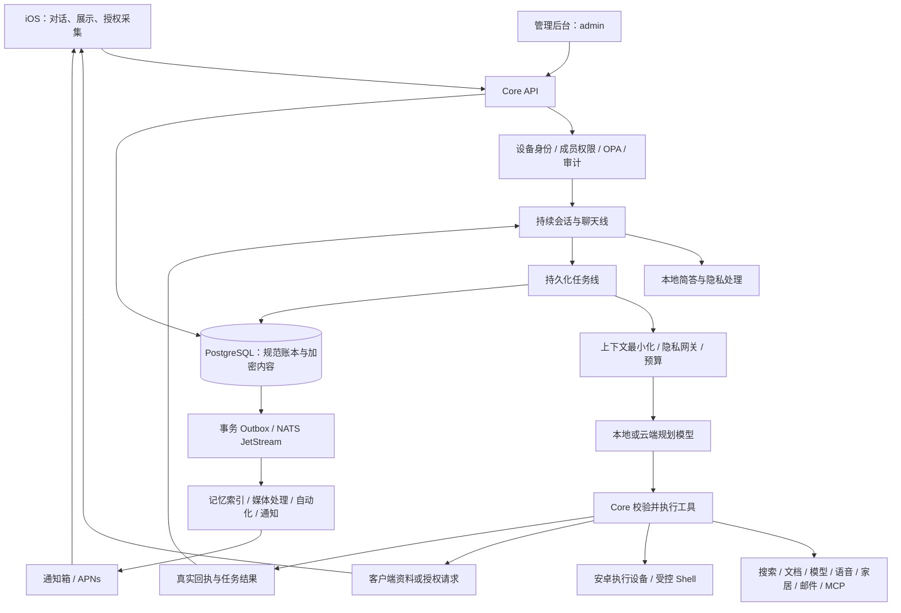
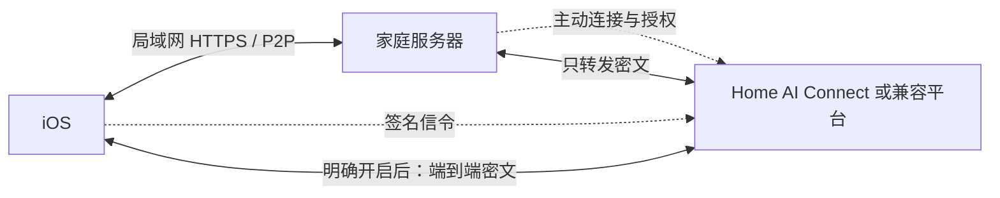

# Home AI OS

Home AI OS 是运行在家庭服务器上的私人 AI 助理系统，包含原生 iOS 客户端、网页管理后台和可替换的能力服务。聊天、资料、记忆与任务保存在自己的家庭服务器；本地使用不依赖平台注册或付费。

**客户端负责输入、展示和必要的设备采集，服务端负责上下文、模型路由、工具调用、审批、任务执行与结果交付。** 简单问题直接回答；需要查资料、操作设备或执行流程时，聊天先反馈，独立任务继续工作，完成后回到原问题汇报。

当前为持续开发版本。代码实现、真实接入、真机验证和生产验收是不同状态；支持某个 Provider 不代表所有模型、设备与应用组合都已通过验收。

- [部署与运维](docs/部署与运维.md)：安装、凭据、模型、通知、备份、安卓与 Shell 配置。
- [架构与开发规范](docs/架构与开发规范.md)：模块边界、协议、任务状态与权限。
- [管理后台验证](docs/管理后台验证.md)：部署后的操作检查。
- [来源与兼容性](docs/来源与兼容性.md)、[验收记录](docs/验收记录.md)、[贡献指南](CONTRIBUTING.md)。

## 能做什么

| 能力 | 当前行为 |
|---|---|
| 持续聊天 | 每位成员一个服务端会话；Markdown、上下文追问、任务结果关联、附件和结构化成员提及 |
| 服务端任务 | 多步骤工具调用、预算、取消、失败重试、补充信息后恢复、执行结果不明时核对 |
| 搜索与资料 | 对话中按需搜索；保留部分可用搜索结果；上传图片、视频和文件，引用已有资料 |
| 数据与记忆 | 数据包含文件、照片、位置和健康记录；记忆保存有来源的聊天偏好与事实，两者分别展示 |
| 健康数据 | 按需采集 14 类常用 HealthKit 指标；优先复用已有记录，缺少指标单独请求；睡眠按区间去重与分期统计 |
| 提醒与自动化 | 家庭服务器定时或按事件执行；个人和家庭可见性分开；结果进入通知箱并按配置推送 |
| 语音 | 转写、原地朗读、分句自动朗读、语音对话及 CallKit 来电链路；各链路需对应服务和系统配置 |
| 安卓执行设备 | 成员专属真机或模拟器；服务端 AI 操作，iOS 小窗、全屏、系统画中画和人工接管 |
| Shell | 默认关闭；启用后支持隔离工作区及本机登记的宿主管理动作 |
| 远程访问 | 局域网与 P2P 直连，另可明确启用端到端加密备用通道；不保证所有网络都能打洞 |

iOS 最低支持 iOS 18，主页面为 **AI、记忆、自动化、数据、设置**。家庭后台用于配置与运维，不是浏览其他成员私人聊天、记忆或资料的入口。

## 系统架构



Core 是 Python 模块化单体，以 API 和后台 Worker 分进程运行。PostgreSQL 保存规范数据；pgvector、Mem0、Graphiti 是检索或派生能力，不能持有唯一副本。Provider 通过能力契约调用，不获得核心数据库凭据。管理后台使用 React、TypeScript、Vite，构建后由 Core 同源提供 `/admin/`。

Home AI Connect 是**独立闭源项目**，本仓库仅包含家庭端和 iOS 的接入实现，不包含平台服务、运营后台、套餐数据库或部署凭据。

## 一次对话怎样完成

1. **输入**：iOS 提交文字、附件引用、数据引用、结构化 `@成员` 以及已授权的设备上下文。每次消息使用幂等标识。
2. **保存**：Core 校验设备签名与会话归属，保存原问题、任务和创建时的上下文快照。
3. **分流**：普通聊天由本地模型简短回答；需要执行的请求交给任务线。聊天接话按实际请求生成，不使用固定的成功承诺。
4. **规划**：服务端选择模型。云调用必须经过隐私网关；模型只提出计划，不能自行取得权限或执行命令。
5. **执行**：Core 校验工具参数、成员权限、预算和批准范围。已取得的资料先复用；真正缺信息时生成持久请求，等待期间仍可继续聊天。
6. **交付**：任务结果按原任务关联原问题，聊天线依据真实工具回执汇报。失败不能伪装成功，也不能把后来的问题当作旧任务的交付对象。

简单聊天支持流式文字。任务结果完成后再作为独立回复出现，可展开查看状态和操作卡片。任务取消、超时与失败保留明确状态；未知副作用不会盲目重试。

### 历史、同步与朗读

- 完整会话保存在服务器，模型只读取当前问题需要的有界上下文；无关历史里的健康或位置资料不会自动带入新任务。
- 应用先展示按身份隔离的加密缓存，再同步服务端状态。文字待发队列沿用原消息标识，重连不重复执行任务。
- 数据或权限变化后，服务端返回重新校验的会话快照，客户端一次性替换；后台刷新不先清空整页。断开状态订阅时先核实业务通道可用性。
- AI 接话、回答、任务结果、等待及失败文字都提供朗读入口。自动朗读默认开启，可在设置关闭；流式内容按完整句合成播放，历史不会自动重播。
- 朗读与缓存音频播放前重新校验正文和来源。已删除、撤权或过期的内容不能通过旧音频继续读取。分句播放不等于 TTS Provider 提供原始音频流式接口。

### 数据、健康与记忆

**数据**是上传或采集的资料：文件、图片、视频、健康与位置等。个人数据仅本人可见；标为家庭共享的数据按家庭权限展示。文件按项共享，位置与健康的持续共享规则由成员自行设置，不能由管理员默认开启。

**记忆**是由本人聊天产生的长期偏好与事实，保留来源、版本和修改／遗忘能力。普通无冲突偏好可以自动保存；敏感内容或冲突事实按对应规则处理。网页、工具推测、临时位置、电量和他人临时授权资料不能直接变成个人长期记忆。

健康分析先检索本人已保存资料，按本次指标和时间范围重新计算统计。已有睡眠和步数时，不把它们与缺少的心率重新打包申请；补充后合并原任务资料。旧记录覆盖不足会明确标为部分数据，空样本不能当作零值，也不能据此认定用户拒绝系统权限。同一任务已查询而无样本的范围不反复申请；明确要求重采或实时数据时仍需真实采集。

目前支持睡眠、步数、心率、体重、静息心率、心率变异性、呼吸频率、血氧、活动能量、静息能量、运动时间、步行跑步距离、体温和体脂率。一次查询最多 31 天、20,000 个样本，分块传输；超限明确失败，不静默截断。这不是对所有 HealthKit 数据类型或医疗诊断能力的承诺。

### 请求、审批与自动审核

默认情况下，需要确认的操作显示在对话卡片中，包含本次指令、用途、范围和影响。缺少信息时补充后恢复原任务，已完成步骤不重做。

输入框的 **自动审核默认关闭**。确认风险提示后开启，显示橙色警告；服务器自动处理当前设备发起、本人有权批准的请求，包括工具审批、指定资料授权、云端披露及允许强制继续的隐私复核。关闭 App 后该设置仍有效；关闭确认返回后停止新的自动批准，已批准操作可能继续执行。

自动审核不扩大成员、工具或宿主机权限，不代替其他成员批准，也不能绕过秘密过滤、禁用操作与系统权限。密码、验证码、选择文件、缺少的信息仍需真实输入；手机健康或位置采集仅在已有系统权限且前台可执行时自动进行。

### 自动化、提醒与通知

执行和调度在家庭服务器，客户端只展示规则、状态与结果。个人规则展示给本人，家庭规则按家庭范围展示；管理员角色不等于读取所有私人规则内容。

提醒必须有真实保存回执。明确的单一时间由 Core 按任务时区核对，缺少事项时只补问事项；定时提醒和周期自动化分别处理。通知箱始终由服务器保存；系统推送需配置自己的 APNs，推送不携带家庭业务正文。

## 模型与可插拔能力

后台“模型与凭据”配置本地简答、本地隐私处理、云端规划、视觉、图片生成和图片编辑用途。一个模型可以承担多个用途，但文字、工具、视觉和生图分别验证；“已启用”不等于验证通过。

内置目录提供本地模型与 SearXNG 搜索的部署入口。SearXNG 是自托管聚合搜索服务，获准的公开搜索词仍会发送给配置的上游引擎；部分引擎失败时保留真实可用结果。

云模型使用可配置的兼容接口。家庭与成员的每日 Token 额度可设置有限值、继承、`0` 停用或“不限”；每日额度不限不取消单任务的步骤、时间和调用保护。默认任务限制为 16 个工具步骤、8 次云调用、64K 规划 Token、单次输出 2K Token；实际请求受服务端契约约束。

MCP 工具必须显式映射，目录变化不能自动扩权。导入的指令型 Skill 只提供处理指引，不自动执行其附带脚本。模型、语音、记忆、文档、邮件与家居能力均可停用或替换，具体配置见 [部署文档](docs/部署与运维.md)。

## 连接方式



家庭端主动连接平台，不要求家庭路由器开放入站端口。有可用局域网地址时直接连接；远程尝试 P2P。家庭后台还可选择允许 **端到端加密备用通道**，优先使用已验证的可用路径，再尝试直连。

备用通道通过平台 HTTPS 转发 HPKE 密文，家庭 API 令牌、路径、参数及结果位于密文内部；iOS 验证扫码时保存的家庭服务器身份。平台仍掌握账号、授权、时间和密文大小等元数据，不能宣称平台完全看不到用户信息。

关闭备用通道后保持严格直连；打洞失败会不可用，不暗中启用 TURN 或 frp。安卓实时视频、声音与原始触控仍使用独立 P2P 媒体通道，未接入 HTTP 密文备用通道。iOS 挂起后连接可能中断，服务端任务继续，回前台后恢复和补拉；没有后台永久在线或零等待保证。

## 开始部署

在家庭服务器准备 Python、Docker Compose 和 Node.js 后：

```sh
python3 -m venv .venv
.venv/bin/pip install -r requirements.lock
.venv/bin/pip install --no-deps -e .
.venv/bin/python scripts/dev_env.py
docker compose --env-file .env.local -f deploy/compose.dev.yml up -d
.venv/bin/python scripts/migrate.py --runtime
.venv/bin/homeai init-key
.venv/bin/python scripts/tls.py
npm --prefix admin-web ci
npm --prefix admin-web run build
```

以上为首次开发部署。已有安装保留主密钥、配置和数据，仅执行适用的增量升级；当前数据库迁移到 `0033`。开发证书只含本机地址，部署者须配置手机可达的 HTTPS 入口。**不要把服务器的 `localhost` 当作 iPhone 的连接地址。**

分别启动 API 和任务执行器：

```sh
.venv/bin/uvicorn homeai.api:create_app --factory --host 0.0.0.0 --port 58443 \
  --ssl-keyfile state/tls/server.key --ssl-certfile state/tls/server.crt
# 在另一个终端运行
.venv/bin/python -m homeai.worker
```

按需要启动记忆、媒体、通知、语音、备份和内置服务执行器。创建管理员与网页登录凭据：

```sh
.venv/bin/homeai bootstrap --name 家庭管理员
.venv/bin/homeai web-setup --user <上一步返回的user_id>
```

打开家庭服务的 `/admin/`，用一次性初始化凭据完成账号和 TOTP 绑定。日常使用用户名与动态码登录，网页会话有效期 24 小时。初始化凭据、数据主密钥、TOTP 和模型 API Key 各有用途，不能互换。

后台创建成员并生成二维码，iOS 扫码取得连接地址与稳定服务器身份。构建客户端：

```sh
xcodegen generate --spec ios/project.yml
open ios/HomeAI.xcodeproj
```

在 Xcode 中配置自己的签名团队与应用标识，连接 iPhone 运行。系统推送、健康权限、语音和后台行为需要真机验证。详见 [部署与运维](docs/部署与运维.md)。

## 当前边界

- 尚未完成全场景家庭生产验收；Linux 隔离、全部 Provider 组合、异机恢复和密钥恢复仍须分别验证。
- 安卓支持通用远控与受控任务执行，不代表所有购物、打车及支付 App 均已适配；密码与身份验证由本人处理。实体熄屏默认关闭，亮屏恢复兼容性未通过。
- 普通 API 的加密备用通道与安卓实时媒体是不同链路；不能把前者通过当作所有网络下的视频可用。
- 语音 Provider、APNs、CallKit 接听、音频和连续对话分别验收；不以收到来电代替通话可用。
- 自动备份默认关闭，位置和频率由用户决定。恢复需重放独立保存的删除与遗忘记录，不能使已删除资料复活。

## 工程目录

```text
server/        Core API、业务模块、迁移与测试
providers/     能力适配器、清单与隔离策略
admin-web/     家庭管理后台
ios/           SwiftUI 原生客户端
android-input/ 第一方安卓输入与触控组件
contracts/     OpenAPI 与 JSON Schema 快照
scripts/       初始化、Worker、组件安装与验证工具
deploy/        开发基础服务、策略及发布镜像配置
docs/          部署、架构、兼容性与验收
```

## 许可证与贡献

自有代码使用 [Home AI OS Attribution License 1.0](LICENSE)，标识为 `LicenseRef-Home-AI-OS-Attribution-1.0`。允许使用、修改、商用、闭源再分发和自行托管；对外提供的衍生产品或托管服务须保留“基于 Home AI OS”及本项目链接，并保留许可要求的版权与免责声明。这是自定义许可，不冒称标准 MIT 或 OSI 认证许可。

第三方组件与模型遵循各自条款，见 [THIRD_PARTY_NOTICES.md](THIRD_PARTY_NOTICES.md)。开发与提交规范见 [CONTRIBUTING.md](CONTRIBUTING.md)。
