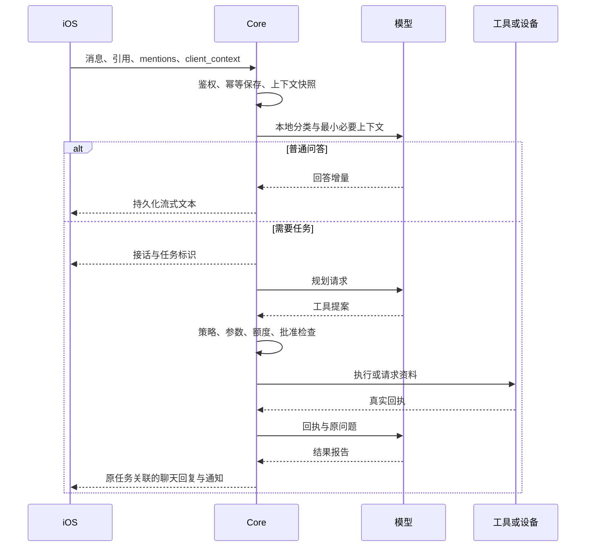

# 架构与开发规范

本文描述当前实现，不把最初计划当作已交付能力。用户流程见 [README](../README.md)，运行命令见 [部署与运维](部署与运维.md)。

## 1. 模块与所有权

| 模块 | 职责 | 主要入口 |
|---|---|---|
| API 与身份 | 配对、签名、成员权限、网页登录和管理配置 | `api.py`、`security.py`、`pairing.py` |
| 会话与聊天 | 持续会话、创建时上下文、增量同步、流式回答与结果交付 | `conversations.py`、`history_scope.py`、`chat_stream.py`、`chat_delivery.py` |
| 任务运行时 | 持久步骤、锁、幂等、预算、取消、恢复和工具派发 | `agent.py`、`runtime.py`、`worker.py` |
| 资料与记忆 | 加密数据账本、共享、删除、记忆来源和派生索引 | `data.py`、`memory.py`、`auto_memory.py` |
| 健康与客户端请求 | 指标采集契约、已有数据复用、统计、补充信息及任务级授权 | `client_actions.py`、`health_reuse.py`、`health_summary.py` |
| 模型与隐私 | 角色路由、能力验证、脱敏、一次性披露及额度 | `model_routing.py`、`cloud_gateway.py`、`privacy_review.py` |
| 自动审核 | 当前配对设备的显式批准委托 | `auto_review.py`、`approval_service.py` |
| 外部能力 | 固定 Manifest、显式映射、真实调用和生命周期 | `providers.py`、`providers/` |
| 远程连接 | 稳定家庭身份、P2P 与可选密文备用通道 | `connect_signalling.py`、`encrypted_relay.py`、`relay_crypto.py` |
| 安卓与 Shell | 设备控制权、受控动作、输入隔离、宿主策略 | `android_*.py`、`shell_*.py` |
| 通知与语音 | 持久通知箱、APNs、语音轮次与通话状态 | `notifications.py`、`voice_calls.py`、`voice_worker.py` |

这些业务模块位于 `server/homeai/`。Core API 和 Worker 共享规范数据与服务接口，不让 Provider 直接导入 Core 或取得数据库凭据。PostgreSQL 是事实源；向量、图谱、搜索缓存可停用和重建。

## 2. 会话和任务分离

每位成员有一个默认持续会话。消息提交保存用户原话、幂等键和任务；客户端不能注入系统角色、历史助手回答或工具计划。

- 创建时已完成的轮次保留当时结果；未完成的轮次只携带当时输入和状态。后来完成的任务不能倒灌进旧快照。
- 历史按当前问题选择。明确追问重新读取当前有权来源；无关消息不继承旧敏感正文或云批准。
- `display_revision` 用于避免旧回包覆盖较新答案。来源更新要求重验时，`updates` 直接携带已鉴权 `snapshot`；客户端原子替换。旧服务兼容路径保留消息位置并遮蔽待重验正文。
- 状态流断开与家庭 API 不可用分开判断；旧订阅和迟到失败不能覆盖新身份或已恢复的通道。
- 聊天人设使用有限的本人已确认表达偏好，不把记忆、网页或工具文字变成系统指令。

## 3. 持久执行和恢复

| 状态 | 意义与恢复方式 |
|---|---|
| `RECEIVED` / `EXECUTING` | 等待或正在执行；Worker 持有任务派发锁 |
| `WAITING_CLIENT` | 等待资料或补充信息；签名幂等响应恢复同一任务 |
| `AWAITING_APPROVAL` | 等待具体参数的审批；批准后重查权限 |
| `WAITING_PRIVACY` | 出站暂停；可重检、修改副本或在允许范围内批准本次披露 |
| `WAITING_BUDGET` / `WAITING_MEDIA` | 等待额度或附件处理，不能虚报完成 |
| `NEEDS_RECONCILIATION` | 外部副作用结果不明；核对后处理，不盲目重试 |
| `SUCCEEDED` / `FAILED` / `CANCELED` | 明确终态，结果属于原任务 |

写入与 Outbox 在同一事务提交；消费者持久去重。模型只提出结构化参数，实际身份、风险和许可由 Core 决定。多步骤任务已完成的动作不因补充、恢复或重连重复执行。

定时提醒须保存到期时间与通知意图。只有成功回执才能报告设置成功；缺事项而已有时间时只询问事项。明确单一时间由 Core 按任务创建时间和时区核对，复合或模糊时间不能套用一个猜测值。

## 4. 数据、记忆与健康

- `DataRecord` 保存业务资料、版本、分类和共享范围。成员私人数据与家庭共享数据分开授权，基础设施管理员不自动获得成年成员的私人内容。
- 聊天记忆保存来源、事实版本、候选状态和遗忘记录。健康样本、照片、文件、临时位置、工具观察与执行报告不能混入记忆。
- 检索按权限筛选，并按 ID 回到账本再次读取。旧来源删除、分类变化、版本变化或授权撤回会影响旧答案及客户端缓存。
- 删除先阻止读取，再传播到缓存与派生索引。恢复备份必须重放独立删除和遗忘日志。

健康新采集按卡片的指标、时间和单位严格验证，不能用额外指标扩大响应。复用是另一条投影路径：原记录先按原契约校验，再投影本次所需指标与重叠范围；睡眠裁剪并取区间并集，步数等计量值不按时间比例猜测。

`health_reuse` 优先选较新、完整的采集，再用旧资料补其覆盖范围。缺少指标时创建缩减请求，回执到达后合并旧来源；来源版本仍须一致。Core 的 `health_queries` 记录“已经查询但无样本”的事实，不能把缺失变成零值，也不能循环申请同一范围。

新报告先看到最小资料目录；统计值必须来自实际读取。明确追问重建健康统计，不依赖旧助手口头总结。旧资料不能冒充实时数据，明确重采请求仍实际采集。他人资料只按当前有效任务授权使用，不跨任务继承。

## 5. 模型与出站

本地简答、本地隐私处理、云端规划、视觉、生图和编辑图分别配置与验证。模型输出截断、仅思考、拒答、结构错误和上游故障分别处理。聊天线关闭思考，工具线的思考配置按兼容接口能力使用。

出站流程为最小化上下文、分类、规则与本地检测、脱敏、复核、必要授权和披露记录。秘密始终禁止出站；本地检测失败不能自动换云模型检测。占位符映射加密保存在家庭端，绑定任务和来源版本。

家庭凭据使用权与成员数据身份分离。每日家庭/成员 Token 额度、图片额度与单任务限制分别生效；“不限”是明确配置，不是一个大数。预留不等于实际消耗，有可信上游用量后结算；未知结果不通过重试抹掉账本。

## 6. 请求与自动审核

客户端请求采用内置类型：定位、健康、选择附件、补充文本、选项、资料授权等，不执行模型下发的任意手机代码。本人在真实系统权限面板授权，HealthKit 空结果不能证明权限被拒绝。

设备自动审核默认关闭。开启需要签名请求和明确风险确认，委托仅作用于该设备发起、本人有权批准的任务。Worker 与关闭操作使用设备行锁；关闭确认之后不能再产生新的自动批准。所有自动批准保留设备标识与审计。

自动审核不替其他成员授权，不猜测密码、验证码、文件选择或缺少的信息，不解除策略禁止和结果待核对状态。自动采集响应还要重新检查开关、设备与原任务。人工与自动响应保留不同幂等语义，旧人工回执仍兼容。

## 7. 连接、媒体和朗读

- 稳定家庭身份与访问地址分离。二维码可包含局域网和兼容远程入口，证书更新不能静默替换受信身份。
- 局域网 HTTPS 和 P2P 尽量复用；明确允许后使用 HPKE 密文备用通道。平台转发密文并能观察元数据，不拥有家庭正文解密钥。
- 加密请求解封后仍验证设备签名、权限与幂等。拥塞退避保留原请求身份，不把未知副作用重新发送为新操作。
- 安卓实时画面、音频和原始触点是独立 P2P 会话，不能以 API 备用通道可用推断视频可用。
- iOS 挂起可能暂停连接。真实音频/画中画遵循系统生命周期，不用虚假来电或静音音轨保活。

朗读按接话和回答独立标识、去重与停止。服务端 `chat-speech` 返回与会话相同的当前授权投影，缓存音频也必须校验。数据变化暂停播放、保留未播尾段，重新校验后恢复；历史基线不应把新完成结果吞掉。

## 8. 安卓、Shell 与工程约束

安卓控制权绑定成员、设备、任务和版本；人工接管不会被 AI 抢占。AI 应用范围为空表示禁用，单独 `*` 表示全部应用，仍核查控件与动作风险；本人接管不受这份 AI 列表限制。密码和验证由本人处理，阻塞协助完成后先重新观察。

Shell 默认关闭。隔离工作区与宿主管理分别授权；固定容器不挂宿主目录和数据库凭据，宿主动作只允许本机登记的脚本及系统账号权限。Mac 普通容器不代表 Linux 生产隔离已验收。

变更优先保持模块边界和公共契约，不格式化无关代码。新增持久字段使用增量迁移；当前到 `0033`。运行数据、密钥、设备标识、用户内容和闭源平台实现不得进入公开仓库。SQLite 只用于隔离逻辑测试；RLS、数据库锁、真实网络、Provider、真机与恢复分别验证。
